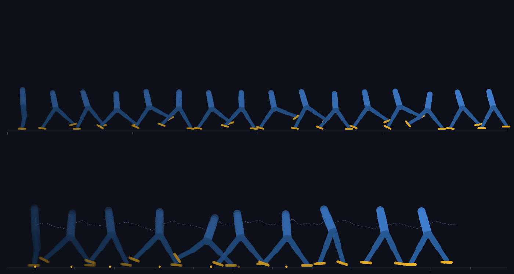

# RL--RUNNING

**Reinforcement learning agents that teach themselves to run.**

No ML libraries. No pretrained weights. No simulation engine. A planar biped, a
rigid-body physics solver, a neural network, backpropagation and PPO — written
from scratch in plain JavaScript, running headless in Node or live in your
browser as a race between independent learners.



*Gait plate for the shipped policy (1.6M training steps): every pose is drawn at
a fixed pitch on top, at its true position below. Amber dots are ground contacts.*

```bash
git clone <this repo> && cd RL--RUNNING
npm test          # 20 tests: physics regression, gradient checks, PPO, worker + UI integration
npm run serve     # then open http://localhost:8787
```

Press **Start** and watch a few agents that begin with random weights and no idea
how legs work. Within a couple of minutes of wall clock time they are running.

---

## What is actually happening

Each **lane** is a fully independent learner: its own simulation, its own neural
network, its own optimiser, its own random seed. Lanes share nothing but the CPU
— which is why two agents given the same reward end up with visibly different
gaits, and why you can watch one fall behind and then overtake.

| Piece | Where | What it is |
| --- | --- | --- |
| Physics | `src/physics.js` | Planar rigid bodies: capsules, revolute joints with torque-limited motors and hard stops, Coulomb friction, warm-started sequential-impulse solver, position projection |
| Task | `src/env.js` | The biped (trunk + 2 legs × thigh/shin/foot), 23 observations, 6 actions, reward shaping, episode logic |
| Network | `src/net.js` | 64×64 tanh trunk + Gaussian policy head + value head, hand-written backward pass, Adam |
| Learner | `src/ppo.js` | Rollouts, GAE(λ), clipped surrogate, minibatch epochs, trust-region early stop |
| CLI trainer | `scripts/train.mjs`, `scripts/lane-worker.mjs` | One OS thread per lane, checkpoints, greedy evaluation |
| Browser race | `public/` | The same modules, in Web Workers, drawn on canvas |
| Dev server | `scripts/serve.mjs` | Serves `public/` *and* `src/`, so the browser imports the very same files the tests do |

### The robot

```
      head
       |                    trunk      (root body)
     [trunk]
     /     \  <- hip         6 actuated joints:
  thigh   thigh                 hip   [-1.60, 1.40] rad,  95 N·m
    |       |                    knee  [-2.50, 0.02] rad,  95 N·m
  shin    shin                   ankle [-0.90, 0.50] rad,  60 N·m
    |       |
   foot    foot
```

Seven rigid bodies, six motors. The policy outputs a **target angle** per joint
(one number in `[-1, 1]`, mapped into that joint's range) and the motor does the
rest, so the same action means the same thing regardless of how fast the
simulation is stepping. Physics runs 5 substeps per control step; control runs at
60 Hz.

### Observations (23 numbers)

Trunk lean (angle, sin, cos) · trunk velocity (x, y) · angular velocity · hip
height · for each leg: hip, knee and ankle angle and angular speed (12) · two
foot-contact flags · a gait-phase clock (sin, cos). The clock is there because
periodic gaits are dramatically easier to discover when the policy can tell time.

### Reward (rates, per simulated second)

| Term | Weight | Why |
| --- | --- | --- |
| Forward speed | **+2.6 / m·s⁻¹** | The actual objective |
| Flight bonus | **+0.9**, scaled by speed above 0.3 m/s | Pays for running, not shuffling |
| Upright | **−0.8 · lean²** | Keeps the trunk vertical |
| Squat | **−3.0 / m** below standing height | Stops the "crawl on the ground" solution |
| Effort | −0.05 · a² | Discourages pointless flailing |
| Jerk | −0.12 · (Δa)² | Smooths the action stream |
| Alive | +0.15 | Small, deliberately: surviving is not the goal |
| Fall | −10, episode ends | Fast is only worth it if it is sustainable |

The flight bonus is the interesting one. Without it, the easiest way to earn
forward reward is to shuffle with both feet dragging along the ground — a local
optimum the policy finds within seconds. Paying for a genuine flight phase is
what pushes it towards an actual stride.

Falling is defined as trunk lean beyond 1 rad, the hip pivot dropping below
0.5 m, or the trunk touching the ground.

### Learning

PPO, the standard formulation:

```
L = −E[ min( r·A , clip(r, 1±ε)·A ) ] + 0.5·E[(V − R)²] − c_h·E[H]
```

- rollout 1024 steps, 3 epochs, minibatch 128, γ = 0.99, λ = 0.95, ε = 0.2
- rewards scaled by 0.1, advantages normalised, gradient norm clipped to 0.5
- Adam at 3e-4; the update stops early once approximate KL exceeds 0.04
- Gaussian policy with a learned log standard deviation; evaluation uses the mean

Two things are worth calling out:

1. **The backward pass is written by hand**, and `test/net.test.js` gradient-checks
   it against central finite differences — 61 parameters, worst relative error
   1.6e-6 — while asserting that both branches of the clipped surrogate are
   exercised. Hand-written gradients that are merely *plausible* are the most
   common way an RL implementation silently learns nothing.
2. **The eight bugs that mattered were found by measurement, not inspection.**
   Damage-per-joint comments in both `test/` and the source record them: the
   contact solver counting angular velocity twice (resting boxes launched
   themselves at 81 rad/s), friction impulses warm-started and then collapsing
   when the normal impulse dipped (kicking sliding bodies backwards), Baumgarte
   push-out applied at the velocity level (free energy: a dropped box bounced to
   3.9 m), motors whose impulse budget saturated and then delivered no torque at
   all, and a trainer that read the module-level action size instead of the
   policy's — harmless at the default size, NaN for any other.

---

## Results

The reference policy in `runs/champion` (trained in about three minutes on two
cores, 1.6M steps per lane) evaluates over 20 episodes on fixed start conditions:

```
distance   median 20.27 m   mean 20.29 m   best 21.73 m
speed      1.35 m/s mean (4.9 km/h), peaks at 2.75 m/s (9.9 km/h)
stability  0% of episodes ended in a fall, 58% of the time on the ground
```

The figure at the top of this file is that policy's stride: an alternating leg
cycle with real knee flexion, a genuine flight phase, and a trunk that stays level
while bobbing a few centimetres per step. Generate your own for any checkpoint
with `npm run gait -- <policy.json>`.

`shots/03-learning-curves.png` is the run that produced it. The shape is the story:
nothing for 100k steps while the agent learns not to fall over, a jump at ~150k
when it finds a shuffle, a second jump at ~500k when it abandons the shuffle for a
stride with a flight phase, then refinement. The thin lines are individual
episodes, which stay noisy to the end — a fast run and a stumble are drawn from
the same policy on adjacent episodes.

`shots/01-shuffle-300k-steps.png` is the earlier, worse gait: stiff legs, no knee
flexion, shuffling at 0.4 m/s. Keeping it around is the point — it is the local
optimum almost every agent finds first.

---

## Commands

```bash
npm test                     # all 14 tests (~3 s)
npm run serve                # the browser race, http://localhost:8787
npm run train -- --lanes 2 --steps 2000000 --out runs/champion
npm run bench                # throughput on this machine
npm run chart -- runs/champion --out runs/champion/curves.png
npm run play -- runs/champion/lane1-best.json --episodes 20
npm run gait -- runs/champion/lane1-best.json --out runs/gait.png
```

Useful flags:

```bash
node scripts/train.mjs --lanes 4 --minutes 10        # run by wall-clock budget
node scripts/train.mjs --lanes 2 --load runs/champion/lane0-best.json --perturb 0.05
node scripts/train.mjs --lanes 1 --hidden 128,128    # a wider network
node scripts/gait-strip.mjs --random                 # untrained reference figure
```

`scripts/train.mjs` writes to the `--out` directory:

- `laneN-best.json` / `laneN-latest.json` — policies (the same JSON the browser loads)
- `laneN-history.json` — `[steps, distance]` per finished episode, for plotting
- `run.json` — the whole session, written at the end

Checkpoints are plain JSON with base64 float32 blobs, so they are inspectable and
portable between Node and the browser:

```bash
node -e "const p=require('./runs/champion/lane1-best.json'); console.log(p.format, p.hidden, p.obsSize+'->'+p.actSize, p.logStd)"
```

## Measuring it

`npm run bench` on a 2-core container, Node 22:

| | |
| --- | --- |
| Environment only | **28–33k steps/s** (≈470–550× realtime) |
| Full PPO training, 1 lane, 1 core | **5.1–5.6k steps/s** |
| Two lanes in parallel | **10.5–11.3k steps/s** aggregate (≈2× one core, one worker per lane) |
| A 1.6M-step-per-lane run, 2 lanes | **2m32s** |
| Policy parameters | 6,157 |

The thin-looking policy throughput (~36k forward passes/s) is a JavaScript
reality rather than a design choice: a hand-written `Float64Array` matrix
multiply reaches about **1 GFLOP/s** in this JIT, and that is the ceiling the
whole design is budgeted against. A PPO minibatch update is ~20 MFLOP, so an
update costs about the same as 1000 environment steps — which is why the update,
not the simulation, dominates the training rate.

## What you should see

Distance per episode, greedy evaluation, 0% fall rate:

| Training steps | Typical greedy distance |
| --- | --- |
| 50k | 0.2 m (it has learned to stand) |
| 200k | 2 – 5 m (shuffling) |
| 600k | 12 – 18 m (a real stride, ~1.2 m/s) |
| 1.5M+ | 15 – 30 m, peaks above 2.5 m/s (9 km/h) |

Early policies find a stiff flat-footed shuffle — knees barely bending, short
steps, one second per stride. Later they discover knee flexion, a flight phase
and a longer stride. `npm run gait` renders a stroboscopic film strip of both
panels (a pose flipbook and a world-space trace) plus the measured pace, so the
gait is inspectable without opening a browser.

## Repository layout

```
src/           physics.js  env.js  net.js  ppo.js  math.js   (shared, dependency-free)
public/        index.html  style.css  app.js  lane.js  format.js
scripts/       serve.mjs  train.mjs  lane-worker.mjs  bench.mjs
               play.mjs   chart.mjs  gait-strip.mjs  render.mjs  champion.mjs
test/          physics.test.js  net.test.js  lane.test.js
runs/          trained policies (JSON) and rendered figures
```

Node ≥ 18 is required (worker threads, `node --test`, ES modules). The browser
app should work in any evergreen browser with module workers (Chrome, Edge,
Firefox 114+, Safari 15+).

## Design notes

- **The same bytes run everywhere.** `public/lane.js` imports `../src/ppo.js`;
  Node's tests import `src/ppo.js`; `scripts/lane-worker.mjs` imports it too.
  There is no build step and no browser bundle, so a physics or maths change is
  exercised by the tests before it can reach the screen.
- **Determinism.** Every environment and every policy owns a seeded PRNG
  (mulberry32), and the simulation is fixed-step. Same seed, same code, same
  curve — the physics tests assert bit-identical trajectories.
- **Floating point honesty.** Bodies are simulated in metres, the renderer scales
  into pixels, and the showcase environment resets between episodes so a good
  runner does not walk into the precision limits of a `Float64` renderer.
- **Turbo vs watch.** In the browser the learner always runs flat out; a separate
  `showcase` environment replays the current policy at animation speed. The robot
  you see is the real policy — it is just not the environment the learner is
  grinding through at 5,000 steps/s.

## License

MIT — see `LICENSE`.
